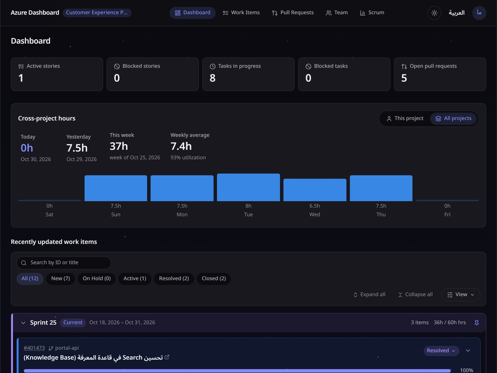
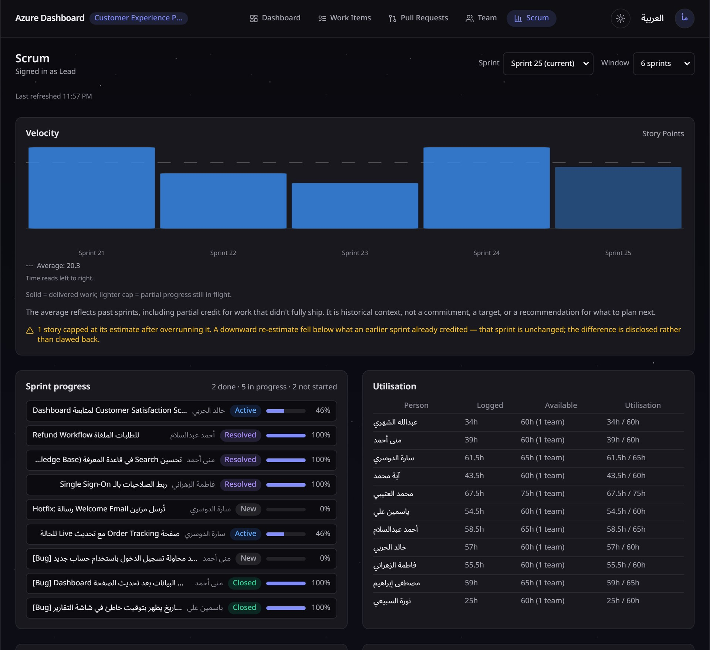
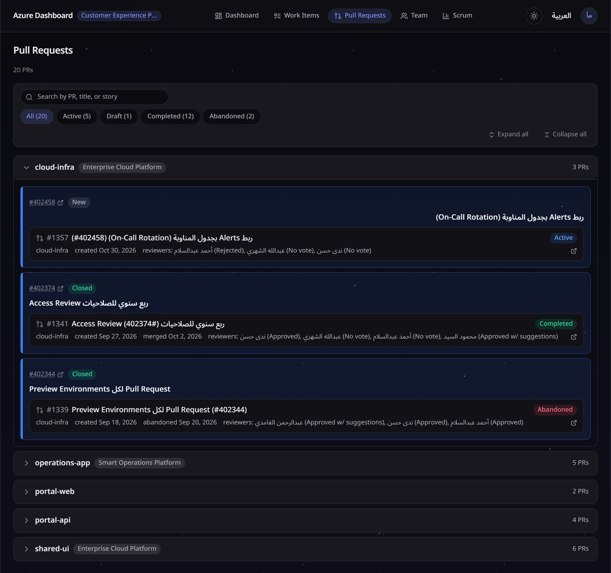
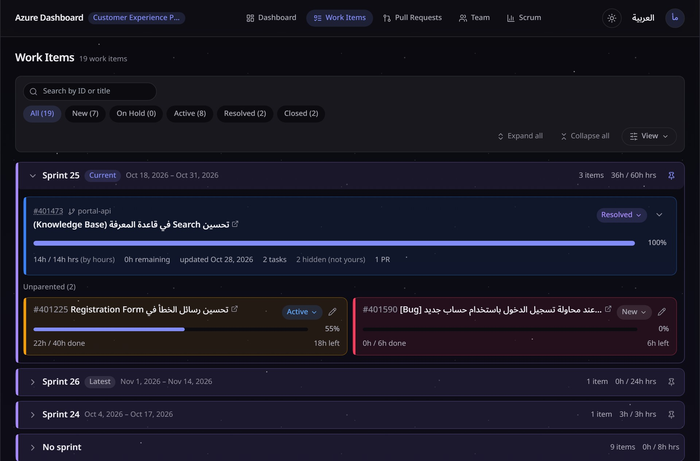
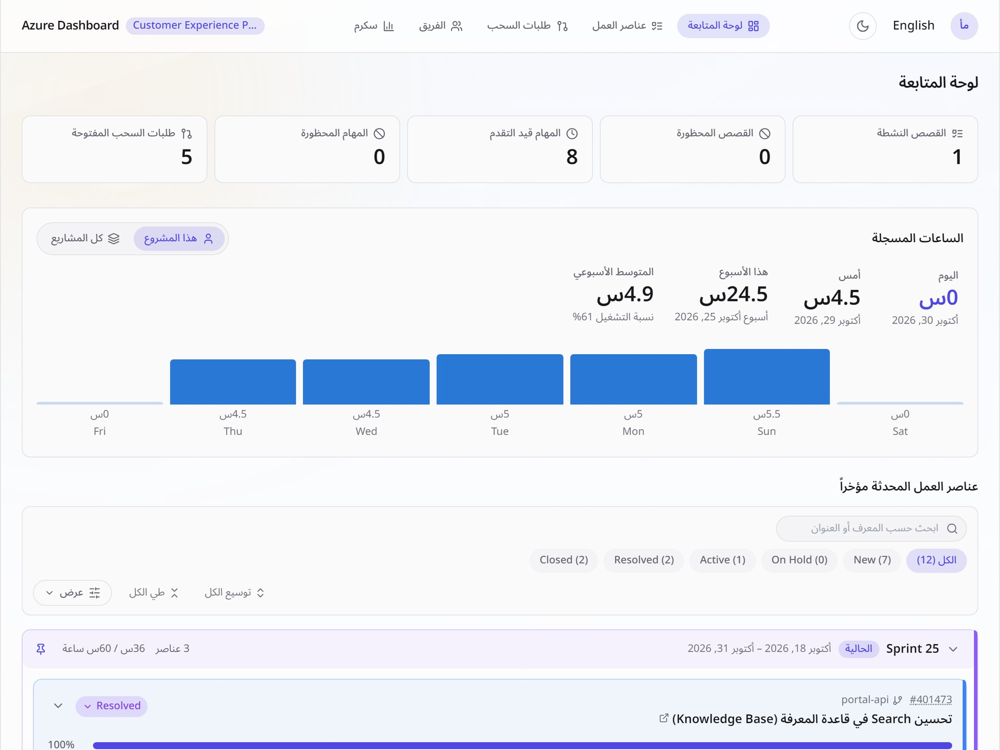

# Azure DevOps Dashboard

A self-hosted dashboard on top of Azure DevOps for developers and team leads. It puts a developer's own
work items, logged hours and pull requests in one place, and gives leads a team view and Scrum analytics
for the sprint.

I built it as a solo project after noticing that developers had no clear view of their own work: logging
time meant typing raw numbers into Azure DevOps, with no easy way to see the picture afterwards.



> **This repository ships with a demo mode.** Out of the box you can run the whole app against a fictional
> company ("Masar Technologies") with generated work items, people and pull requests. No Azure DevOps
> account is needed and the demo makes no network calls to Azure DevOps. All names, projects and data in
> the screenshots and in demo mode are made up.

## What it does

- **Dashboard**: active and blocked stories, tasks in progress, open pull requests, and an hours card
  (today, yesterday, this week, weekly average). Click a day on the chart to see which work items took the
  time. A *This project / All projects* switch combines hours across every project you can access.
- **Work items**: grouped by sprint, with child tasks and bugs under each story, hours against estimate,
  and related pull requests. **Cumulative progress** lets you select several items and see their combined
  hours and percentage.
- **Pull requests**: grouped by repository across repos. Each PR is attributed to its story from the PR
  title, the work items Azure DevOps links to it, and its commit messages (one hop up to the parent story),
  so stories show their PRs even when nobody linked them.
- **Team view and Manage Team**: leads pick members and see each one's dashboard; the org chart (roles and
  reporting lines) is stored on the project's own wiki.
- **Scrum analytics**: velocity, burndown, story progress, capacity utilisation, blocked and stalled work,
  and scope change.
- English and Arabic (full RTL layout), light and dark themes.
- Writes (log hours, change state, move sprint) go to Azure DevOps under the signed-in person's own token,
  and are rejected if the item changed in the meantime.

| | |
|---|---|
|  |  |
|  |  |

## Stack

Node.js 16 and Fastify for the API (`server/`), React, TypeScript, Vite and Tailwind CSS for the front end
(`web/`), Azure DevOps REST APIs for data. About 480 tests run offline with `npm test`.

## Try the demo

Requirements: **Node.js 16.x** (a hard pin in `package.json`) and npm.

```bash
git clone https://github.com/mu7amed-ragab/azure-devops-dashboard.git
cd azure-devops-dashboard

npm install
npm install --prefix web     # the client has its own install

npm run demo                 # builds the client, then serves the demo on http://127.0.0.1:5180
```

Open <http://127.0.0.1:5180> and sign in:

| Step | Value |
|---|---|
| Password | `demo` |
| Token | `demo-lead` (team lead, sees every page), `demo-member` (developer) or `demo-principal` |
| Project | `Customer Experience Portal`, `Smart Operations Platform` or `Enterprise Cloud Platform` |

Changes you make in the demo (hours, states, sprint moves) work but live in memory and disappear on
restart. Details of the generated data are in [server/demo/README.md](server/demo/README.md).

On Windows PowerShell the same commands work; use `npm run demo` as shown.

## Turn it into a real dashboard

The demo and the real app are the same code. Demo mode is only switched on by `npm run demo`
(`DEMO_MODE=1`), so running the normal start command uses your real Azure DevOps organization.

1. **Stop the demo** and make sure `DEMO_MODE` is not set in your shell or `.env`.
2. **Create your config:**
   ```bash
   cp .env.example .env
   ```
   Set the two required values:
   - `ADO_ORG`: your organization name (the part after `dev.azure.com/`).
   - `APP_PASSWORD`: a long random phrase. It is the shared password that gates sign-in.

   Optional: `ADO_PROJECT` (project preselected at sign-in), `ADO_PAT` (shared service token for background
   polling), `SESSION_SECRET` (set it explicitly in production; generate with `openssl rand -base64 32`).
3. **Create a personal access token** at `https://dev.azure.com/<your-org>/_usersSettings/tokens` with these
   scopes: Work Items (Read & Write), Code (Read), Project and Team (Read), Wiki (Read & Write). The Wiki
   scope is only needed for saving changes in *Manage Team*.
4. **Start it:**
   ```bash
   npm start                # builds the client, then serves on http://127.0.0.1:5174
   ```
5. **Sign in** with the team password, then your own token, then pick a project from the list your token
   can read.

The first sync of a project takes one to two minutes because the app builds an index of work item revision
history to compute hours per day. It is cached under `.cache/` and later starts are fast.

Every person signs in with their own token, so their writes show up in Azure DevOps under their own name.
Pull requests, hours and team pages need no extra setup. For team charts, create a wiki page
`/Dashboard Roles` in the project (the *Manage Team* screen does this for you).

### Deploying for a team

- **Docker:** the included `Dockerfile` builds the client at image-build time. Set `ADO_ORG`,
  `APP_PASSWORD` and `SESSION_SECRET` as environment variables and expose port 5174.
- **Render:** `render.yaml` deploys the **demo** (it sets `DEMO_MODE=1`, so it needs no Azure DevOps account). For a real deployment, use `deploy/render.real.yaml` and set `ADO_ORG`, `APP_PASSWORD` and `SESSION_SECRET` in the Render dashboard.
- **Windows service / IIS:** the `deploy/` folder has a service definition, an update script and a
  `web.config` example. Edit the paths first.

Put the app behind HTTPS if it is reachable beyond localhost. The full guide covers the login gate, token
handling, rotation, and the configuration reference: [docs/full-guide.md](docs/full-guide.md).

## Known limitations

- Pull request search matches the PR number, PR title and story ID. It does not search by story title.
- Node.js is pinned to 16.x.
- It is built for one Azure DevOps organization per deployment.
- Access control is a shared password plus each person's own token. It is meant for a team that already
  trusts each other with the same Azure DevOps organization, not for public exposure.
- Sessions are encrypted cookies without a server-side store, so one person's session cannot be revoked
  individually; rotating `SESSION_SECRET` signs everyone out.

## Project layout

```
server/        Fastify API, Azure DevOps client, sync engine, demo mode (server/demo/)
web/           React + TypeScript client
test/          offline tests (npm test)
tools/         test runner, demo screenshot capture
docs/          architecture notes, invariants, full operations guide
deploy/        Windows service / IIS examples
```

More background: [docs/architecture-server.md](docs/architecture-server.md),
[docs/architecture-client.md](docs/architecture-client.md), [docs/invariants.md](docs/invariants.md),
[CONTRIBUTING.md](CONTRIBUTING.md).

## License

[MIT](LICENSE) © 2026 Mohamed Ragab
